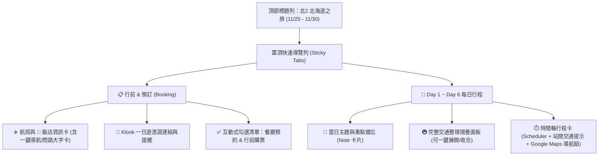

# 「北2」北海道六日遊 — 手機版行程網頁設計計畫

本計畫旨在將 [行程.md](file:///c:/Users/hippo/Documents/Hokkaido/%E8%A1%8C%E7%A8%8B.md) 轉換為專為**手機單手瀏覽、旅途中即時查詢**所設計的互動式 HTML 網頁。

> [!IMPORTANT]
> **100% 內容完整保留原則**：`行程.md` 中的所有航班、飯店、Klook 連結、待辦預約清單、每日 Note 備忘、交通票價／班次時刻（如巴士發車時間、地鐵出口、計程車車資預估）與 Scheduler 時間軸皆會**完整保留、不刪減任何細節**。

---

## 一、 檔案架構與技術選型

* **單一檔案架構 (`index.html`)**：
  * 將 HTML5、RWD CSS 樣式與原生 JavaScript 封裝於單一 `c:\Users\hippo\Documents\Hokkaido\index.html` 檔案中（同時支援直接透過手機瀏覽器開啟、傳送至 LINE/AirDrop 離線檢視，或放上 GitHub Pages）。
  * **零外部框架依賴**：不需安裝 Node.js 或編譯打包，確保載入速度極快且在北海道訊號不穩處（如洞爺湖、美瑛山區）也能流暢瀏覽文字內容。
* **本機狀態儲存 (`localStorage`)**：
  * 勾選「需預訂餐廳」、「行前確認/購票」的 Checkbox 狀態，以及上次瀏覽的「天數分頁 (Day Tab)」，會自動記憶在手機瀏覽器中，重新整理不會遺失。

---

## 二、 介面與互動設計 (Mobile-First UI/UX)

### 1. 置頂天數與功能切換列 (Sticky Navigation Bar)
* 固定於手機畫面頂部，支援水平滑動點選：
  * `📋 預訂/行前` | `D1 11/25(三)` | `D2 11/26(四)` | `D3 11/27(五)` | `D4 11/28(六)` | `D5 11/29(日)` | `D6 11/30(一)`
* 點擊分頁時平滑切換並自動捲動至該日頂部。

### 2. 「📋 預訂/行前 (Booking)」專區
* **航班資訊卡**：
  * 去程：虎航 `IT234` (`06:20 TPE → 10:55 CTS`)
  * 回程：虎航 `IT235` (`11:55 CTS → 15:35 TPE`，醒目提示 `11:10 關櫃 / 10:00 往國際線報到`)
* **飯店資訊卡 (`the b sapporo`)**：
  * 入住 `11/25 15:00` / 退房 `11/30 11:00` (Rakuten Travel)
  * 附帶 **「📍 Google Maps 導航」** 按鈕與 **「🚕 給司機看 (日文地址放大卡)」** 彈窗（方便 Day 1 從 Sports Depo 搭計程車或市區移動時直接出示）。
* **一日遊快速連結**：
  * 整合 Day 2 (登別洞爺湖) 與 Day 3 (青池精靈露台) 的 Klook 活動頁面按鈕，並加上醒目的 `⚠️ 行前確認最終憑證接送時間` 警示標章。
* **互動式 Checklists（支援點擊打勾與進度條顯示）**：
  * **需預訂餐廳**（3 項：Yakiniku Kiraku、小樽北唐辛子本店［附 `tel:0134-24-8929` 撥號連結］、札幌かに家［附官網連結］）。
  * **行前確認/購票**（2 項：Chiikawa Land 整理券確認、小樽天狗山纜車）。

### 3. 「📅 Day 1 ～ Day 6」每日行程檢視
每一天的頁面將 `###Note`、`[交通整理]` 與 `###scheduler` 三大區塊結構化整合，提供兩種互補的閱讀體驗：

1. **當日主題與重點備忘卡 (`###Note`)**：
   * 以分類標籤呈現當日餐飲（早餐/早午餐/午餐/晚餐/宵夜）、採買清單（如 Sports Depo 外套雪靴、WORKMAN 中內層襪子、Bic Camera 刮鬍刀免稅提醒）與特殊時間提醒（如小樽 16:04 日落、堺町通打烊時間、週日地鐵一日券 `¥520`）。
2. **雙模式交通資訊呈現 (`[交通整理]`)**：
   * **模式 A（時間軸站間嵌入）**：在 `scheduler` 兩個行程點之間，直接穿插對應的交通膠囊提示（例如在 `14:30 Sports Depo` 與 `16:15 WORKMAN Plus` 之間，直接顯示計程車方案1與公車方案2），旅途中不必上下來回翻找。
   * **模式 B（當日完整交通整理總覽）**：在每日上方保留可展開/收合的「🚇 當日交通整理總覽」區塊，100% 呈現 `行程.md` 原文條列，方便整日路線預覽。
3. **時間軸行程卡片 (`###scheduler`)**：
   * 每個時間點包含：
     * **時間標籤**（如 `13:10`）與 **類別圖示**（✈️ 機場 / 🏨 飯店 / 🍛 美食 / 🛍️ 購物 / ⛩️ 景點 / 🚇 車站）
     * **地點名稱**與對應的當日備註提示
     * **「📍 地圖」按鈕**：點擊直接開啟手機 Google Maps 搜尋該景點／店家精確位置。

---

## 三、 視覺風格與配色 (北國冬雪主題)

* **色彩計畫**：
  * **背景色**：冰川霧白 (`#F4F7FB`) 與純白卡片 (`#FFFFFF`)，提升戶外雪地強光下的閱讀清晰度。
  * **主色調**：北海道深海藍 (`#1E3A5F`) 與冰晶藍 (`#0284C7`)。
  * **強調色**：暖湯琥珀橘 (`#EA580C` / `#F59E0B`，用於重要警示 `⚠️`、必吃美食與營業時間提醒）。
  * **深色模式切換 (🌙 Dark Mode)**：右上角提供一鍵切換深色主題，方便在夜間景點（大通公園白色燈樹節、白金青池、森林精靈露台、天狗山夜景）低光源環境下觀看手機不刺眼。
* **字體與排版**：
  * 採用高易讀性系統無襯線字體 (`-apple-system`, `BlinkMacSystemFont`, `"Noto Sans TC"`, `"Hiragino Kaku Gothic ProN"`)，時間與金額採用等寬對齊數字 (`tabular-nums`)。
  * 所有按鈕與勾選框皆符合手機觸控規範（最小點擊區域 `44x44px`），支援 iOS Safe Area 底部留白。

---

## 四、 待確認事項 (Review Questions)

請您檢視以上設計計畫，並告訴我是否有需要調整的地方：

1. **檔案輸出位置**：預設將產出 `c:\Users\hippo\Documents\Hokkaido\index.html`，是否符合您的預期？
2. **交通資訊呈現方式**：計畫採用「在時間軸各站之間嵌入對應交通方式」＋「頂部可展開完整交通總覽」雙軌設計，您喜歡這樣的呈現嗎？
3. **其他客製功能需求**：是否需要額外加入小工具（例如：**簡易日幣匯率換算器**、或是 **計程車日文手指問路卡**）？

確認無誤後，請回覆或點擊執行，我將立即為您生成完整的手機版 HTML 網頁！
